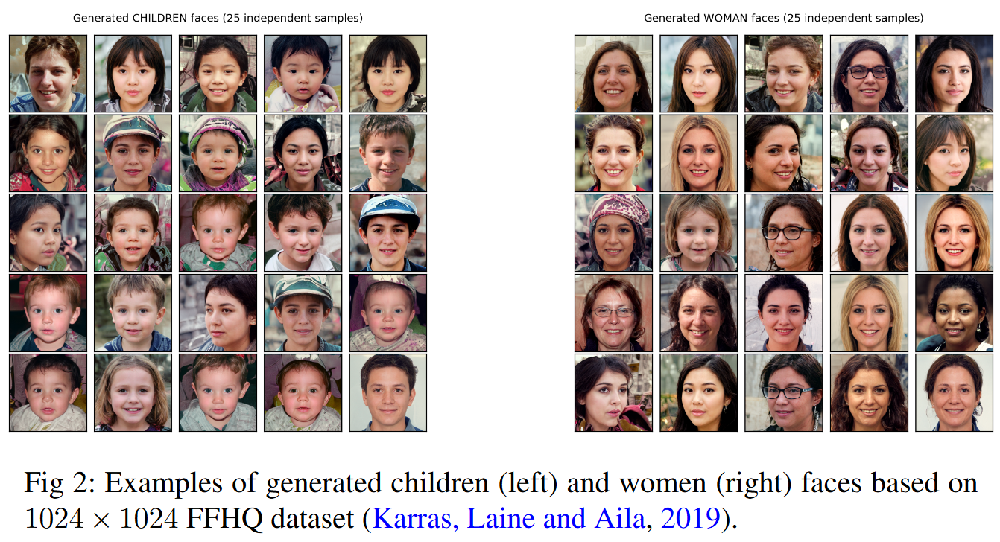

# Sample complexity of Schrödinger potential estimation

`PyTorch` code reproducing the numerical experiments of **Sample complexity of Schrödinger potential estimation** by [Denis Belomestny](https://scholar.google.com/citations?user=WFjIBlcAAAAJ), [Alexey Naumov](https://scholar.google.com/citations?user=5723KoYAAAAJ&hl=en), [Nikita Puchkin](https://scholar.google.com/citations?hl=en&user=xc8HXnMAAAAJ) and [Denis Suchkov](https://scholar.google.com/citations?user=whaT9tkAAAAJ&hl=en), submitted to the *Annals of Statistics*.

The estimator is a Schrödinger bridge with an Ornstein–Uhlenbeck reference process: the potential is parameterised as a mixture of Gaussians and fitted by minimising the constrained objective analysed in the paper.

<p align="center"></p>

## Repository layout

```
src/schr_bridge.py     Schr_Bridge — potential, normalising constant, transport map
src/distributions.py   samplers used by the notebooks
notebooks/             experiments
ALAE/                  vendored Adversarial Latent Autoencoder (Pidhorskyi et al., CVPR 2020)
data/                  pretrained ALAE latents and FFHQ attributes (downloaded, not tracked)
example.png            generated children and women faces, Figure 2 of the paper
```

The notebooks are shipped without stored outputs; every figure is produced by running them.

## Installation

Python 3.8 or newer.

```bash
pip install -r requirements.txt
```

### Pretrained ALAE weights

The two ALAE notebooks need the vendored autoencoder and its pretrained FFHQ generator:

```bash
pip install -r ALAE/requirements.txt
cd ALAE
python training_artifacts/download_all.py
echo training_artifacts/ffhq/model_157.pth > training_artifacts/ffhq/last_checkpoint
cd ..
```

The script downloads `model_submitted.pth`, `model_194.pth` and `model_157.pth` (~1.3 GB in total) from the Google Drive of the ALAE authors, falling back to their S3 bucket `alaeweights.s3.us-east-2.amazonaws.com`, into `ALAE/training_artifacts/ffhq/`. The same files can be fetched by hand from [this Drive folder](https://drive.google.com/drive/folders/1tsI1q1u8QRX5t7_lWCSjpniLGlNY-3VY). ALAE loads the weights named in the file `last_checkpoint`, which the download script does not create; the line above selects `model_157.pth`, the checkpoint used for the reported figures.

### Data

`data/` holds the ALAE encodings of the FFHQ images and their attributes: `latents.npy` (70 000 × 512 latent vectors), `gender.npy` and `age.npy`; the ALAE notebooks use the first 60 000 rows. The three files (~150 MB) are downloaded from Google Drive by the notebooks themselves — set `DOWNLOAD_DATA = True` in the configuration cell and run the download cell once.

## Experiments

All notebooks are run from inside `notebooks/`, resolve `src/` and `ALAE/` through relative paths, and write their figure next to themselves.

| Notebook | Experiment | Figure |
| --- | --- | --- |
| [`gauss_standard.ipynb`](notebooks/gauss_standard.ipynb) | 25 isotropic Gaussians on a regular 5×5 grid | `standard_50.png` |
| [`gauss_irregular.ipynb`](notebooks/gauss_irregular.ipynb) | 25 isotropic Gaussians with uniformly drawn means | `irregular_50.png` |
| [`gauss_anisotropic.ipynb`](notebooks/gauss_anisotropic.ipynb) | 25 randomly rotated anisotropic Gaussians | `anisotropic_50.png` |
| [`alae_childs.ipynb`](notebooks/alae_childs.ipynb) | generation of children faces in the ALAE latent space | `childs_generation_gallery.png` |
| [`alae_womans.ipynb`](notebooks/alae_womans.ipynb) | generation of women faces in the ALAE latent space | `womans_generation_gallery.png` |

In the first three, a truncated standard Gaussian in $\mathbb{R}^2$ is transported onto the target mixture; the Ornstein–Uhlenbeck parameters `B` and `MU` in the configuration cell were selected by an Optuna search and are hard-coded so that the figures reproduce directly. In the last two, a truncated standard Gaussian in the 512-dimensional ALAE latent space is transported onto the latents of an FFHQ subset and decoded back to images. Each notebook runs on CPU.

## Third-party code

`ALAE/` is a copy of the [official Adversarial Latent Autoencoder repository](https://github.com/podgorskiy/ALAE) by Pidhorskyi, Adjeroh and Doretto (CVPR 2020), redistributed under the Apache 2.0 license of that project. It serves only as a pretrained encoder/decoder of the FFHQ latent space; the sole change to the published code is `training_artifacts/download_all.py`, rewritten to fetch the weights with `gdown` instead of `dlutils`.

## License

The code in `src/` and `notebooks/` is released under the MIT license, see [LICENSE](LICENSE).