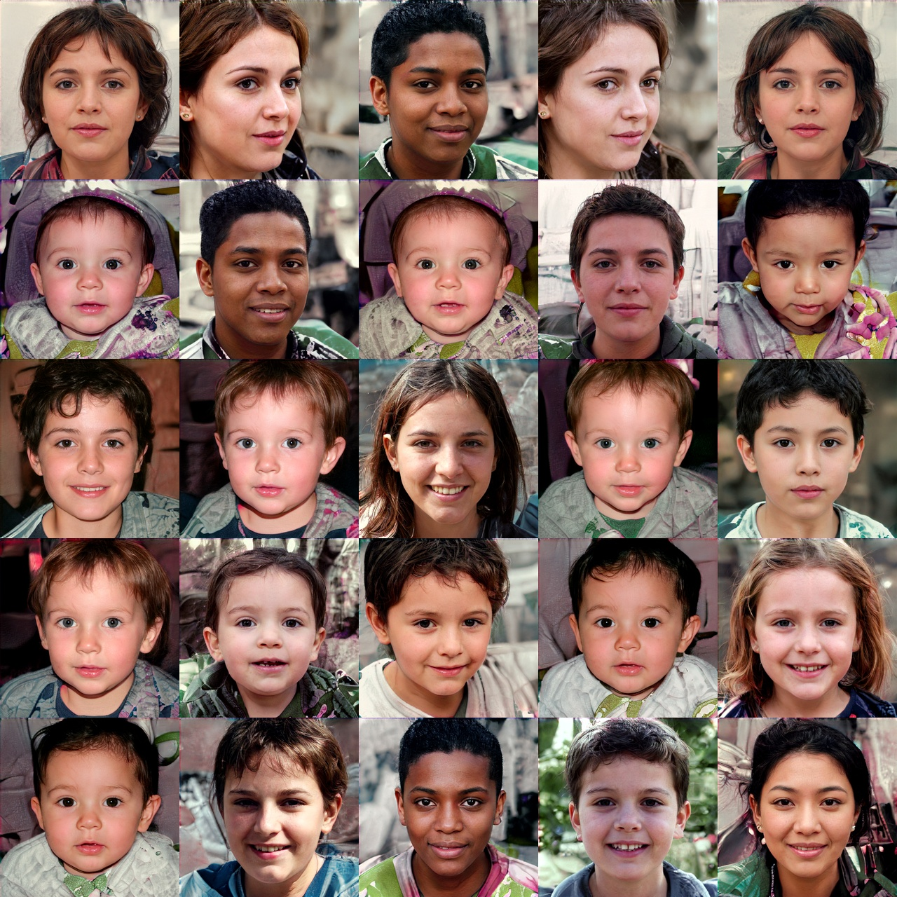
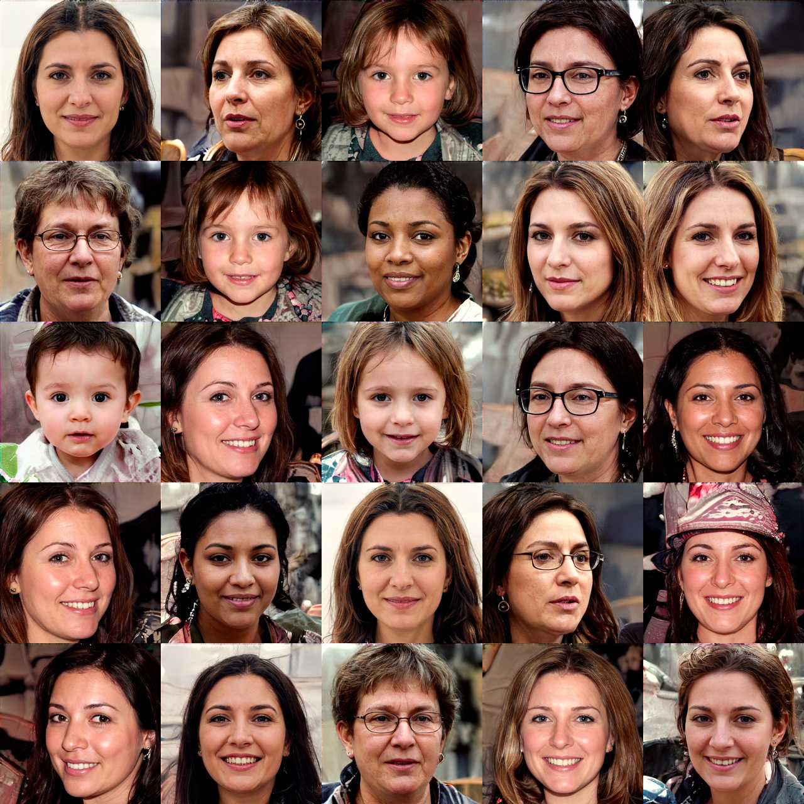

# Sample complexity of Schrödinger potential estimation

`PyTorch` code reproducing the numerical experiments of **Sample complexity of Schrödinger potential estimation** by [Denis Belomestny](https://scholar.google.com/citations?user=WFjIBlcAAAAJ), [Alexey Naumov](https://scholar.google.com/citations?user=5723KoYAAAAJ&hl=en), [Nikita Puchkin](https://scholar.google.com/citations?hl=en&user=xc8HXnMAAAAJ) and [Denis Suchkov](https://scholar.google.com/citations?user=whaT9tkAAAAJ&hl=en), submitted to the *Annals of Statistics*.

The notebooks fit Gaussian-mixture potentials for a Schrödinger bridge with an Ornstein–Uhlenbeck reference process. Each notebook uses fixed parameters. Run the cells in order from the `notebooks/` directory.

## Gaussian mixtures (Table 1 and Figure 1)


Each notebook fits one diagonal, 50-component model using 5,000 Adam updates, batch size 128, and learning rate 0.002. The reference parameters are $T=10$, $\epsilon=0.1$, and $m=C(1,1)^\top$. The notebooks store $b$ and $C$ at full precision; the displayed parameters below are rounded as in the paper.

| Notebook | $b$ | $C$ | Sliced Wasserstein | $10^5$ × squared MMD | Energy distance |
|---|---:|---:|---:|---:|---:|
| [Standard](notebooks/gauss_standard.ipynb) | 1.1415 | 0.0151 | 0.090 ± 0.016 | 2.92 ± 6.03 | 0.0025 ± 0.0009 |
| [Irregular](notebooks/gauss_irregular.ipynb) | 1.1644 | −0.0278 | 0.098 ± 0.040 | 2.36 ± 12.59 | 0.0031 ± 0.0028 |
| [Anisotropic](notebooks/gauss_anisotropic.ipynb) | 0.7260 | −0.0710 | 0.118 ± 0.020 | 7.47 ± 9.76 | 0.0040 ± 0.0015 |

The **Published Table 1 row** cell recalculates the printed numbers from the five archived evaluations embedded in the notebook. The subsequent cells train a fresh model with the fixed parameters, evaluate it independently, and save the first draw as a Figure 1 panel. Numerical libraries, hardware, and PyTorch versions can change the fresh fit even with the same seed. Each entry is a mean ± standard deviation (divisor five) across five evaluations of the same fit. Each evaluation draws 10,000 generated endpoints and 10,000 fresh target samples. Fresh CPU fits on Ubuntu with PyTorch 2.5.1 reproduced all three rows to the displayed precision. Allow several GB of free RAM for the pairwise distances used by the median-bandwidth calculation.

## FFHQ latent-space galleries (Figure 2)

| Child subset | Female-labeled subset |
|:---:|:---:|
|  |  |
| [Child notebook](notebooks/alae_childs.ipynb) | [Female-label notebook](notebooks/alae_womans.ipynb) |

Both notebooks use the first 60,000 aligned FFHQ records. The child subset contains 10,762 records with reported age below 18, and the female-labeled subset contains 32,816 records of any age. The subsets overlap in 6,345 records. Each fit uses $K=50$, $T=15$, $\epsilon=0.2$, $m=0$, and 10,000 Adam updates at learning rate $10^{-4}$ with batches of 128. The child and female-labeled fits use $b=0.917004$ and $b=3.363586$, respectively. Each gallery shows all 25 samples from seed 42. The published galleries used CUDA. A CPU fallback is available; device and library differences can change individual samples.

## Run the notebooks

The published experiments used Python 3.11 and PyTorch 2.5.1. For the face galleries, install a CUDA-enabled PyTorch build if using a GPU. From the repository root:

```bash
python -m pip install -r requirements.txt
cd notebooks
jupyter notebook
```

The Gaussian notebooks generate their synthetic data. For the face notebooks, set `DOWNLOAD_DATA = True` in the configuration cell on the first run to fetch `latents.npy`, `age.npy`, and `gender.npy` into `data/`. The decoder uses the pretrained FFHQ ALAE checkpoint `model_157.pth`. To install the weights with the provided downloader, run the following from the repository root:

```bash
cd ALAE
python training_artifacts/download_all.py
echo training_artifacts/ffhq/model_157.pth > training_artifacts/ffhq/last_checkpoint
```

The downloader uses the ALAE authors' Google Drive files with an S3 fallback. The notebook loads the checkpoint named in `last_checkpoint`.

## Third-party code

The pretrained encoder and decoder are from [ALAE](https://github.com/podgorskiy/ALAE) (Pidhorskyi, Adjeroh and Doretto, CVPR 2020). The vendored implementation is distributed under the Apache 2.0 license; see [ALAE/README.md](ALAE/README.md).

## License

The code in `src/` and `notebooks/` is released under the MIT license, see [LICENSE](LICENSE).